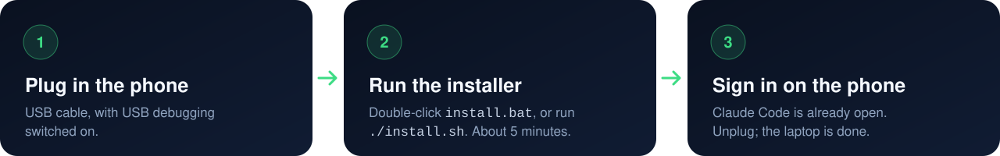

  

  
  
  
  
  

  <a href="#install"><b>Install</b></a> &nbsp;·&nbsp;
  <a href="#what-you-do-by-hand">What you do by hand</a> &nbsp;·&nbsp;
  <a href="#what-it-changes-on-the-phone">What it changes</a> &nbsp;·&nbsp;
  <a href="#remove">Remove</a> &nbsp;·&nbsp;
  <a href="#troubleshooting">Troubleshooting</a> &nbsp;·&nbsp;
  <a href="docs/usb-debugging.md">USB debugging guide</a>

 

Put [Claude Code](https://code.claude.com) on an Android phone by plugging it into a laptop and running one command. Nothing is typed on the phone during the install, and the laptop is not needed afterwards.

  

> [!NOTE]
> Unofficial community project. Not made, endorsed or supported by Anthropic. "Claude" and "Claude Code" are Anthropic's trademarks.

## Why this one

- **The laptop does the typing.** Other guides have you type dozens of commands on a phone keyboard. Here the laptop sets everything up over the cable.
- **It explains itself.** The installer fetches the Android tool it needs, waits for the phone, and tells you in plain words what to tap.
- **Safe to run again.** A pulled cable or dropped Wi-Fi is fine: run it again and it carries on. On a working install it changes nothing.
- **It asks first.** An existing Termux is never touched or replaced without your say-so.
- **It cleans up.** One command removes what it added and puts the phone's settings back.

## What you need

- An Android phone: Android 7 or newer, 64-bit ARM (nearly every phone from the last several years), about 3 GB of free space, and Wi-Fi.
- A laptop running Windows, macOS or Linux, and a USB cable that carries data.
- A Claude account that includes Claude Code, or an Anthropic API key, to sign in on the phone.

The phone does not need to be rooted.

## Install

1. **Get this folder onto the laptop.** Click **Code > Download ZIP** on GitHub and unzip it, or `git clone` the repo.
2. **Plug in the phone and switch on USB debugging.** Settings > About phone > tap "Build number" seven times, then Settings > System > Developer options > USB debugging. Some brands need one or two extra switches: see [docs/usb-debugging.md](docs/usb-debugging.md).
3. **Run the installer.**
   - Windows: double-click `install.bat`. If Windows shows "Windows protected your PC", click **More info > Run anyway**.
   - macOS / Linux: open a terminal in the folder and run `./install.sh`.

The installer tells you what to do at each point. It takes about 5 to 10 minutes. When it finishes, Claude Code is open on the phone, waiting for you to sign in.

After that, to use it: open the **Termux** app and type `claude`.

## What you do by hand

The install needs no typing on the phone, but a few things only you can do:

1. Switch on Developer options and USB debugging (step 2 above).
2. Tap **Allow** when the phone asks "Allow USB debugging?". Tick "Always allow from this computer".
3. On some brands, tap **Install** when the phone asks about installing an app over USB.
4. Keep the phone unlocked while the installer runs.
5. Sign in to Claude on the phone at the end. This part does involve the phone's keyboard.

If the laptop has no `adb` (the Android tool that talks to the phone), the installer offers to download Google's copy into this folder. Nothing is installed on the laptop itself. On Windows, a few phone brands also need the maker's USB driver; the installer links to it if the phone does not show up.

## What it changes on the phone

| Change | Detail |
|---|---|
| Installs the Termux app | Version 0.118.3 from [Termux's GitHub releases](https://github.com/termux/termux-app/releases), checked against a fingerprint pinned in `versions.env`. Skipped if this build is already there. |
| Updates Termux's packages and adds `proot-distro` | Only when a current `proot-distro` is not already installed. Config files you edited are kept. |
| Adds a Linux guest named `claude-code` | Debian 13 (slim), about 600 MB, inside Termux. The image is pinned by its digest in `versions.env`. |
| Installs Claude Code in that guest | With [Anthropic's own installer](https://code.claude.com/docs/en/setup), downloaded over HTTPS from claude.ai. |
| Adds a `claude` command to Termux | If Termux already had one, it is set aside untouched and put back on uninstall. |
| Lets Termux show notifications, and wakes the screen | So Termux can unpack and open. A swipe-only lock screen is opened; a PIN or pattern is not bypassed. |
| Adds a one-time start-up hook | A small file in Termux's `profile.d` that lets the installer open Claude Code once without typing. |
| Keeps its notes in `~/.claude-code-android` | Inside Termux. |
| Lifts Android's background-process limit | Android 12 and newer only. Without this, Android can stop Claude Code mid-session. On some phones Android resets it after a restart; running the installer again sets it back. |

Your Claude settings and sign-in live in `~/.claude` in Termux, outside the guest. Your project files live wherever you put them in Termux.

On the laptop, everything stays in this folder (`.tools`, `.cache`, `logs`), apart from the key adb creates in your user folder so the phone can recognise the laptop.

If the laptop has no adb, the copy the installer downloads from Google is a pinned version, checked against a fingerprint in `versions.env` before it is used.

If the phone already has Termux, the installer stops and asks before touching it. If that Termux came from the Play Store or F-Droid, it has to be replaced, which deletes everything inside it; the installer does this only after you type `REPLACE`, and it refuses up front if Termux add-ons would block the replacement.

## Running it again

Running the installer again is safe. It checks what is already there, finishes anything that was interrupted (a pulled cable, lost Wi-Fi), and changes nothing on a working install.

## Remove

- Windows: double-click `uninstall.bat`.
- macOS / Linux: `./uninstall.sh`.

This removes the Linux guest, the `claude` command and the start-up hook, and puts the background-process setting back. Termux, your files and your Claude settings stay. If the installer was the one that installed Termux, it then offers to uninstall Termux and everything in it, which happens only if you type `REMOVE`. A Termux you had before is never offered for removal.

## Things to know

> [!IMPORTANT]
> **The Termux build used here is easier to read from outside than the Play Store one.** It is the build from Termux's GitHub page, the only one a laptop can set up. Two things follow:
>
> - Any computer you have tapped "Allow" for can read Termux's files over USB debugging, including your Claude sign-in. When you are done, switch USB debugging off (Claude Code keeps working), tap "Revoke USB debugging authorisations" in Developer options, and only ever tap "Allow" on computers you trust.
> - Termux's GitHub builds are signed with a key that [Termux publishes openly](https://github.com/termux/termux-app#installation). An app signed with that key could share Termux's files, so do not install Termux add-ons or "Termux" apps from places you do not trust.

- **Lifting the background-process limit** lets apps keep more background programs running, which can cost some battery. Uninstalling puts it back.
- **It is slower than on a laptop.** Claude Code runs inside a Linux guest, which adds overhead, mostly on tasks that touch many files.
- **Android may still stop Termux** on phones with aggressive battery saving. If sessions die when the screen is off, set Termux's battery use to "Unrestricted" in the phone's app settings.

## Troubleshooting

| Problem | Try |
|---|---|
| "Waiting for your phone..." never ends | Use another cable or port (many cables only charge). Set the phone's USB mode to "File transfer". On Windows, install the phone maker's [USB driver](https://developer.android.com/studio/run/oem-usb). |
| "Allow USB debugging?" never appears | Unlock the phone, unplug the cable and plug it back in. In Developer options, tap "Revoke USB debugging authorisations" and try again. |
| "The phone blocked the install" | See your brand in [docs/usb-debugging.md](docs/usb-debugging.md). |
| Stops with a network error | Check the phone's Wi-Fi and run the installer again. It continues where it stopped. |
| `claude` gets killed during long sessions | Developer options > switch on "Disable child process restrictions" (Android 14+), and set Termux's battery use to "Unrestricted". |
| Anything else | Open an issue and attach the newest file from the `logs` folder. Read it first: it holds the installer's messages, your answers, your phone's make and model, and, after a failure, a few lines of package-manager output from the phone. It does not include your files or your Claude sign-in. |

## Status

- Confirmed: Windows 10 laptop with a OnePlus Nord CE (Android 13). A fresh install took under 4 minutes on Wi-Fi.
- Android 7 to 12 and other phone makers: written for, and covered by the automated tests, but not yet confirmed on a real phone.
- macOS and Linux: the installer runs the same steps on the phone, and its laptop side is covered by automated tests, but it has not yet been confirmed on real hardware. Reports are welcome.

## How it works

The laptop scripts (`install.ps1`, `install.sh`) only find adb, wait for the phone, download Termux and pass on questions. They copy `phone/setup.sh` to the phone and run it there over adb. That script checks the phone, installs Termux, and runs `phone/termux-setup.sh` inside Termux, which creates the Linux guest and runs `phone/guest-setup.sh` inside it. Claude Code needs a standard Linux system and does not run in Termux directly, which is why the guest is there.

Tests: `bash tests/test-phone.sh`, `bash tests/test-entry.sh sh`, and on Windows `bash tests/test-entry.sh ps`. None of them need a phone.

## License

MIT. See [LICENSE](LICENSE).
